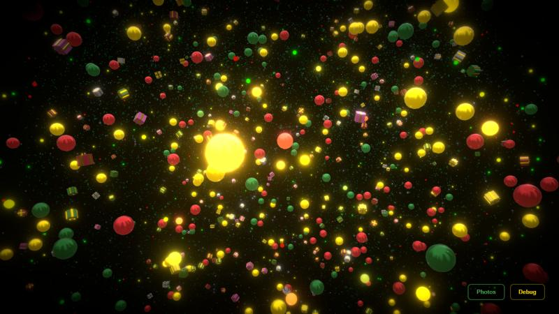

# Cây thông Noel 3D

Cây thông Noel 3D chạy trên trình duyệt, điều khiển bằng **cử chỉ tay qua webcam**. Xoè tay thì hàng nghìn quả cầu, hộp quà, bóng đèn bay tán loạn khắp không gian; nắm tay thì chúng bay về tụ lại thành cây. Bạn có thể đổi màu, đổi kiểu cây và treo ảnh của mình lên cây như ảnh Polaroid.

| Xoè tay: tán loạn | Nắm tay: thành cây |
| --- | --- |
|  |  |

## Cách chạy

1. **Cài Node.js** bản LTS từ [nodejs.org](https://nodejs.org/) (cần bản 20.19 trở lên).
2. **Cài pnpm** (chỉ làm lần đầu). Mở Terminal bất kỳ và chạy:

   ```
   npm install -g pnpm
   ```

3. **Mở Terminal** trong thư mục `christmas-tree-3d` (Windows: chuột phải vào thư mục → **Open in Terminal**).
4. **Cài thư viện** (chỉ làm lần đầu):

   ```
   pnpm install
   ```

5. **Chạy:**

   ```
   pnpm dev
   ```

6. Mở trình duyệt (nên dùng Chrome hoặc Edge) vào **http://localhost:5173** và bấm **Cho phép** khi được hỏi quyền camera.

Lần đầu mở trang cần Internet để tải model nhận diện tay và ảnh môi trường, nên màn hình có thể đen vài giây.

## Cách dùng

**Bằng chuột**

| Thao tác | Kết quả |
| --- | --- |
| Kéo chuột | Xoay quanh cây |
| Cuộn chuột | Phóng to / thu nhỏ |
| Nhấp đúp | Chuyển qua lại giữa tán loạn và thành cây |
| Nút **Photos** | Chọn ảnh trong máy để treo lên cây |
| Nút **Debug** | Hiện hình camera, khung xương bàn tay và tên cử chỉ máy đang thấy |

**Bằng cử chỉ tay** (đưa cả bàn tay vào khung hình camera)

| Cử chỉ | Kết quả |
| --- | --- |
| ✋ Xoè tay | Các món trang trí bay tán loạn |
| ✊ Nắm tay | Tụ lại thành cây |
| 👍 Giơ ngón cái | Đổi màu: Giáng sinh → hồng → tím → xanh |
| ☝️ 1 ngón | Cây hình nón cổ điển |
| ✌️ 2 ngón | Cây nhiều tầng |
| 3 ngón (trỏ, giữa, áp út) | Cây xoắn ốc |
| 🤏 Chụm ngón cái và ngón trỏ | Phóng to tấm ảnh gần tay nhất; thả tay để ảnh về chỗ cũ |

## Gặp lỗi?

| Lỗi | Cách sửa |
| --- | --- |
| `pnpm` không được nhận dạng | Làm lại bước 2, rồi đóng và mở lại Terminal |
| `ERR_PNPM_IGNORED_BUILDS` khi cài | Chạy `pnpm approve-builds`, chọn gói được liệt kê, rồi `pnpm install` lại |
| Màn hình đen rất lâu | Kiểm tra kết nối Internet, rồi tải lại trang |
| `ERROR: Camera permission denied` | Bấm biểu tượng camera / ổ khoá trên thanh địa chỉ → cho phép camera → tải lại trang |
| `ERROR: No camera found` | Cắm webcam vào máy |
| `ERROR: Camera in use by another app` | Tắt các ứng dụng đang dùng camera (Zoom, Meet, OBS...) |
| Cử chỉ không ăn | Bật **Debug** để xem máy đang thấy gì; ngồi chỗ đủ sáng, cách camera khoảng 0,5–1 m |
| Mở thẳng file `dist/index.html` bị trắng trang | Bản build phải chạy qua server: dùng `pnpm preview` |

## Quyền riêng tư

Thư viện nhận diện tay `@mediapipe/tasks-vision` (từ bản 1.x) tự gửi thống kê sử dụng về Google tại `odml.pa.googleapis.com` và chưa có cách tắt. Nếu đưa app lên mạng cho người khác dùng, bạn nên báo trước cho họ (xem [Privacy Notice của MediaPipe](https://www.npmjs.com/package/@mediapipe/tasks-vision)). Muốn tránh hoàn toàn thì đổi sang bản `0.10.35` trong `package.json`; đường dẫn file WASM tự đổi theo.

## Kỹ thuật

Viết bằng React 19 + TypeScript 7, dựng cảnh 3D bằng Three.js thông qua **React Three Fiber** (dùng React để mô tả cảnh 3D), build bằng Vite 8.

- **Hai trạng thái CHAOS / FORMED:** mỗi món trang trí nhớ hai vị trí, một chỗ ngẫu nhiên trong không gian và một chỗ trên cây. Mỗi khung hình, nó tiến dần về vị trí đích bằng *damping* (càng gần đích càng chậm lại), nên chuyển cảnh luôn mượt dù máy nhanh hay chậm.
- **25.000 hạt lá chạy trên GPU:** cả hai vị trí của từng hạt được nạp sẵn vào card đồ hoạ, *shader* (chương trình nhỏ chạy trên GPU, viết bằng GLSL) tự trộn giữa hai vị trí và tô màu tối ở gốc, sáng dần lên ngọn.
- **Instancing:** 300 hộp quà và 400 bóng đèn được vẽ bằng *InstancedMesh*, tức vẽ hàng trăm bản sao của cùng một hình chỉ trong một lần gọi GPU (*draw call*). Riêng hộp quà giảm từ 1.800 xuống 2 draw call.
- **Ba kiểu cây:** vị trí trên cây được tính bằng toán: hình nón (dày ở gốc, thưa ở ngọn), nhiều hình nón cụt chồng lên nhau, hoặc các nhánh xoắn quanh thân. Đổi kiểu chỉ tính lại vị trí đích, các món trang trí tự bay sang chỗ mới.
- **Nhận diện cử chỉ:** MediaPipe Gesture Recognizer chạy ngay trong trình duyệt bằng *WebAssembly* (mã biên dịch chạy gần nhanh như ứng dụng cài trên máy). Nó trả về 21 điểm mốc trên bàn tay; app tự tính thêm cử chỉ chụm tay (khoảng cách đầu ngón cái và ngón trỏ) và đếm ngón.
- **Hậu kỳ:** *Bloom* làm các vùng sáng toả quầng ra xung quanh (đèn, ngôi sao); *Vignette* làm tối dần về các góc màn hình.

**Muốn chỉnh?**

| Muốn đổi | Sửa ở |
| --- | --- |
| Số hạt lá, quả cầu, đèn, hộp quà; kích thước cây | `src/constants/config.ts` |
| Bảng màu các theme | `src/constants/themes.ts` |
| Hình dạng các kiểu cây | `src/utils/treePositions.ts` |
| Ngưỡng nhận diện cử chỉ | `src/gesture/handGestures.ts` |

**Cấu trúc thư mục**

```
src/
├── App.tsx                 # Ghép mọi thứ lại: cảnh 3D, nhận diện tay, thanh nút
├── components/
│   ├── 3d/                 # Cảnh 3D: lá, quả cầu, đèn, hộp quà, ngôi sao, ảnh
│   │   ├── photos/         # Ảnh Polaroid và cách chọn ảnh theo vị trí tay
│   │   ├── scene/          # Camera, ánh sáng, nền trời, hậu kỳ
│   │   └── shared/         # Chuyển động tán loạn ↔ thành cây dùng chung
│   ├── UI/                 # Nút Photos, Debug, dòng trạng thái
│   └── GestureController.tsx
├── gesture/                # Camera + MediaPipe → các sự kiện cử chỉ
├── hooks/                  # Trạng thái của app (theme, kiểu cây, ảnh, zoom...)
├── constants/              # Cấu hình và bảng màu
├── shaders/                # Shader GLSL cho hạt lá
└── utils/                  # Hàm ngẫu nhiên, tính vị trí trên cây
```

Lệnh khác: `pnpm build` (kiểm tra kiểu + build vào `dist/`), `pnpm preview` (xem bản build), `pnpm typecheck` (chỉ kiểm tra kiểu).

## License

MIT, xem [LICENSE](LICENSE).
