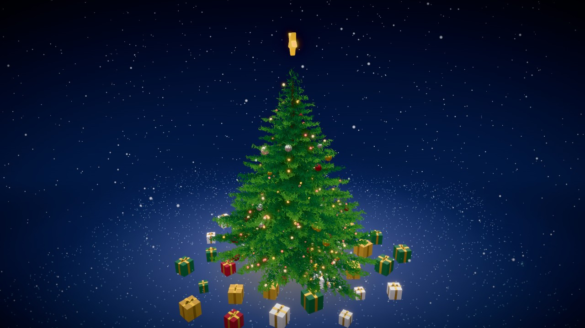

# Cây thông Noel 3D

Cây thông Noel 3D chạy trên trình duyệt, điều khiển bằng **cử chỉ tay qua webcam**. Xoè tay thì lá cây, quả cầu, hộp quà, bóng đèn bay tán loạn khắp không gian; nắm tay thì chúng bay về tụ lại thành cây giữa trời đêm tuyết rơi, quà xếp quanh gốc. Bạn có thể đổi bảng màu và treo ảnh của mình lên cây như ảnh Polaroid.

| Xoè tay: tán loạn | Nắm tay: thành cây |
| --- | --- |
|  |  |

## Cách chạy

1. **Cài Node.js** bản LTS từ [nodejs.org](https://nodejs.org/) (cần bản 20.19 trở lên).
2. **Cài pnpm** (chỉ làm lần đầu). Mở Terminal bất kỳ và chạy:

   ```
   npm install -g pnpm
   ```

3. **Mở Terminal** trong thư mục `christmas-tree-3d` (Windows: chuột phải vào thư mục → **Open in Terminal**).
4. **Cài thư viện** (chỉ làm lần đầu):

   ```
   pnpm install
   ```

5. **Chạy:**

   ```
   pnpm dev
   ```

6. Mở trình duyệt (nên dùng Chrome hoặc Edge) vào **http://localhost:5173** và bấm **Cho phép** khi được hỏi quyền camera.

Lần đầu mở trang cần Internet để tải model nhận diện tay, nên màn hình có thể đen vài giây.

## Cách dùng

**Bằng chuột**

| Thao tác | Kết quả |
| --- | --- |
| Kéo chuột | Xoay quanh cây |
| Cuộn chuột | Phóng to / thu nhỏ |
| Nhấp đúp | Chuyển qua lại giữa tán loạn và thành cây |
| Nút hình tấm ảnh (góc dưới phải) | Chọn ảnh trong máy để treo lên cây |
| Nút hình máy quay (debug) | Hiện hình camera, khung xương bàn tay và tên cử chỉ máy đang thấy |

**Bằng cử chỉ tay** (đưa cả bàn tay vào khung hình camera)

| Cử chỉ | Kết quả |
| --- | --- |
| ✋ Xoè tay | Lá cây và đồ trang trí bay tán loạn |
| ✊ Nắm tay | Tụ lại thành cây, hộp quà xếp quanh gốc |
| 👍 Giơ ngón cái | Đổi bảng màu: Giáng sinh (xanh thông, đỏ, vàng) → hồng phấn → tím → xanh băng |
| 🤏 Chụm ngón cái và ngón trỏ | Phóng to một tấm ảnh; thả tay để ảnh về chỗ cũ. Mỗi lần chụm lại ra một tấm khác |

## Gặp lỗi?

| Lỗi | Cách sửa |
| --- | --- |
| `pnpm` không được nhận dạng | Làm lại bước 2, rồi đóng và mở lại Terminal |
| `ERR_PNPM_IGNORED_BUILDS` khi cài | Chạy `pnpm approve-builds`, chọn gói được liệt kê, rồi `pnpm install` lại |
| Màn hình đen rất lâu | Kiểm tra kết nối Internet, rồi tải lại trang |
| Dòng trạng thái báo đỏ `Camera permission denied` | Bấm biểu tượng camera / ổ khoá trên thanh địa chỉ → cho phép camera → tải lại trang |
| `No camera found` | Cắm webcam vào máy |
| `Camera in use by another app` | Tắt các ứng dụng đang dùng camera (Zoom, Meet, OBS...) |
| Cử chỉ không ăn | Bật nút máy quay (debug) để xem máy đang thấy gì; ngồi chỗ đủ sáng, cách camera khoảng 0,5–1 m |
| Mở thẳng file `dist/index.html` bị trắng trang | Bản build phải chạy qua server: dùng `pnpm preview` |

## Quyền riêng tư

Thư viện nhận diện tay `@mediapipe/tasks-vision` (từ bản 1.x) tự gửi thống kê sử dụng về Google tại `odml.pa.googleapis.com` và chưa có cách tắt. Nếu đưa app lên mạng cho người khác dùng, bạn nên báo trước cho họ (xem [Privacy Notice của MediaPipe](https://www.npmjs.com/package/@mediapipe/tasks-vision)). Muốn tránh hoàn toàn thì đổi sang bản `0.10.35` trong `package.json`; đường dẫn file WASM tự đổi theo.

## Kỹ thuật

Viết bằng React 19 + TypeScript 7, dựng cảnh 3D bằng Three.js thông qua **React Three Fiber** (dùng React để mô tả cảnh 3D), build bằng Vite 8.

- **Hai trạng thái CHAOS / FORMED:** mỗi món trang trí nhớ hai vị trí, một chỗ ngẫu nhiên trong không gian và một chỗ trên cây (hộp quà thì là một chỗ trên mặt đất quanh gốc). Mỗi khung hình, nó tiến dần về vị trí đích bằng *damping* (càng gần đích càng chậm lại), nên chuyển cảnh luôn mượt dù máy nhanh hay chậm.
- **70.000 lá kim chạy trên GPU:** lá mọc dọc theo 230 cành, mỗi cành xoè ra như một cái quạt có các nhánh con chĩa chéo kiểu xương cá, nên tán cây có cành, có khe hở như cây thật. Cả hai vị trí của từng lá được nạp sẵn vào card đồ hoạ, *shader* (chương trình nhỏ chạy trên GPU, viết bằng GLSL) tự trộn giữa hai vị trí, vẽ mỗi hạt thành một lá kim và tô tối ở trong tán, sáng ở đầu cành.
- **Instancing:** 70 quả cầu, 34 hộp quà và 220 bóng đèn được vẽ bằng *InstancedMesh*, tức vẽ hàng trăm bản sao của cùng một hình chỉ trong một lần gọi GPU (*draw call*).
- **Ảnh Polaroid:** mỗi ảnh có một chỗ treo cố định bên ngoài tán lá, mặt hướng ra ngoài; ảnh không vuông được cắt lấy phần giữa cho vừa khung. Mỗi lần chụm tay phóng to một ảnh chưa xem.
- **Khung cảnh:** nền trời đêm chuyển màu, nền tuyết hắt sáng quanh gốc có bụi tuyết lấp lánh, và tuyết rơi (cũng chạy trên GPU).
- **Nhận diện cử chỉ:** MediaPipe Gesture Recognizer chạy ngay trong trình duyệt bằng *WebAssembly* (mã biên dịch chạy gần nhanh như ứng dụng cài trên máy). Nó trả về 21 điểm mốc trên bàn tay; app tự tính thêm cử chỉ chụm tay (khoảng cách đầu ngón cái và ngón trỏ).
- **Hậu kỳ:** *Bloom* làm các vùng sáng toả quầng ra xung quanh (đèn, ngôi sao) nhưng bỏ qua ảnh Polaroid; *Vignette* làm tối dần về các góc màn hình; *tone mapping* nén vùng quá sáng lại để không bị cháy trắng.

**Muốn chỉnh?**

| Muốn đổi | Sửa ở |
| --- | --- |
| Số lá, quả cầu, đèn, hộp quà; kích thước cây | `src/constants/config.ts` |
| Bảng màu các theme | `src/constants/themes.ts` |
| Dáng cây (số cành, cách xếp cành, độ rủ) | `src/utils/treePositions.ts` |
| Hình dáng và màu của lá | `src/shaders/FoliageMaterial.ts` |
| Nền trời, tuyết rơi, độ sáng và Bloom | `src/components/3d/scene/` |
| Kích thước, độ sáng của ảnh Polaroid | `src/components/3d/photos/` |
| Ngưỡng nhận diện cử chỉ | `src/gesture/handGestures.ts` |

**Cấu trúc thư mục**

```
src/
├── App.tsx                 # Ghép mọi thứ lại: cảnh 3D, nhận diện tay, thanh nút
├── components/
│   ├── 3d/                 # Cảnh 3D: lá, quả cầu, đèn, hộp quà, ngôi sao, thân cây, ảnh
│   │   ├── photos/         # Ảnh Polaroid: treo lên cây, chọn ảnh để phóng to
│   │   ├── scene/          # Camera, ánh sáng, nền trời, tuyết rơi, hậu kỳ
│   │   └── shared/         # Chuyển động tán loạn ↔ thành cây dùng chung
│   ├── UI/                 # Nút thêm ảnh, nút debug, icon, dòng trạng thái
│   └── GestureController.tsx
├── gesture/                # Camera + MediaPipe → cập nhật store theo cử chỉ
├── store.ts                # Trạng thái dùng chung của app (zustand): theme, ảnh, zoom...
├── constants/              # Cấu hình và bảng màu
├── shaders/                # Shader GLSL cho hạt lá
└── utils/                  # Hàm ngẫu nhiên, hình dạng cây và vị trí trên cây
```

Lệnh khác: `pnpm build` (kiểm tra kiểu + build vào `dist/`), `pnpm preview` (xem bản build), `pnpm typecheck` (chỉ kiểm tra kiểu).

## License

MIT, xem [LICENSE](LICENSE).
